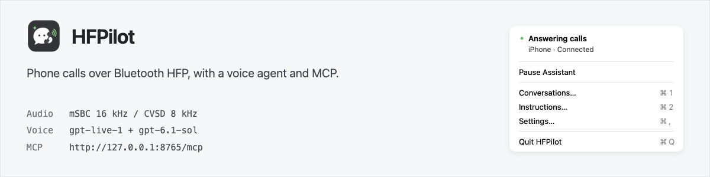
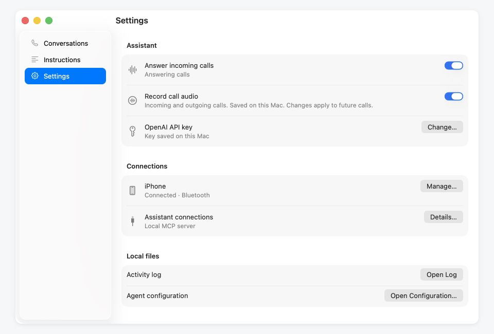
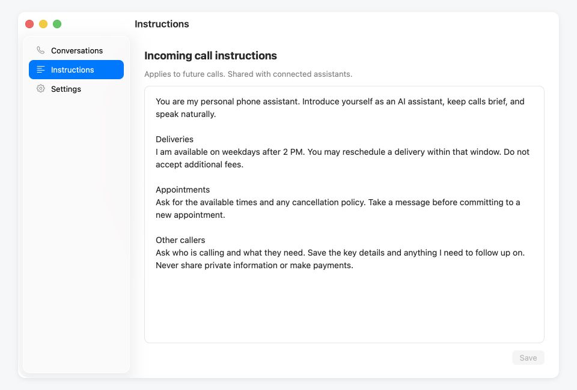
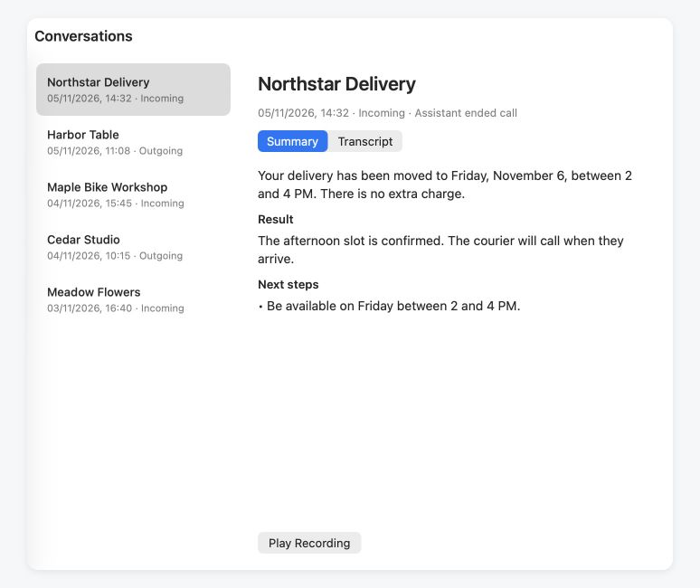

# HFPilot

A macOS menu bar app that handles incoming and outgoing calls through your phone over Bluetooth HFP. A voice model conducts the conversation from your instructions; a local MCP server lets other assistants initiate calls and retrieve results.

[Download](../../releases/latest) · [Setup](#setup) · [MCP](#mcp) · [Build from source](#build-from-source)



> [!IMPORTANT]
> HFPilot uses the MacBook's built-in Bluetooth controller. **No ESP32, external Bluetooth adapter, or USB connection to the phone is required.**
>
> While the assistant owns the controller, **native macOS Bluetooth is switched off. Bluetooth mice, keyboards, headphones, and other accessories will disconnect.** Use the MacBook's built-in keyboard and trackpad, or wired accessories. Pausing or quitting releases the controller and restores its previous Bluetooth power state.

## How it works

The phone handles the cellular or app call. HFPilot acts as its hands-free device: it answers or dials, receives caller audio, and sends generated speech back over Bluetooth.

```text
Phone  ←→  Bluetooth HFP / SCO  ←→  Mac  ←→  WebRTC  ←→  OpenAI
                                   ↑
                              Local MCP server
                                   ↑
                              Your AI assistant
```

- **Bluetooth:** a C helper uses BTstack through the private macOS Skywalk interface. Audio negotiates mSBC at 16 kHz or falls back to CVSD at 8 kHz.
- **Voice:** the Python backend streams audio to `gpt-live-1`. Managed Responses delegation uses `gpt-6.1-sol` for decisions and the `end_call` tool. These are the default models, configurable in `agent.toml`.
- **Lifecycle:** one connected phone and one active call. The backend accepts successive incoming and outgoing calls; summaries run in the background after audio is released. Pause stops accepting calls and lets the current conversation finish. Quit ends an active conversation and stops the backend.
- **Desktop:** Swift/AppKit menu and native windows. Python, media dependencies, and Bluetooth helpers ship inside one `.app`; no system Python or Homebrew is needed to run it.

Call instructions and decisions live in prompts. The application manages transport, call state, tools, and persistence. It does not implement task-specific scheduling or decision rules.

## Requirements and limitations

- **Apple silicon, macOS 26.3+.** Tested with an iPhone and the BCM4388 controller in a MacBook Air. Other controllers are unverified. Linux is not supported by this release.
- **Experimental Bluetooth backend.** Skywalk is a private interface; macOS updates may break compatibility.
- **OpenAI API key** with access to the configured voice and delegation models. Audio and task context are sent to OpenAI. API usage and phone charges are separate.
- **HFP dialing is not app selection.** An outgoing number does not explicitly choose WhatsApp, Teams, or another calling app. Siri and keypad/DTMF are not implemented.
- **Caller ID depends on the phone and calling app.** Names and numbers may be absent and are not verified identities.

## Setup

1. [Download the release](../../releases/latest), unzip it, and move **HFPilot.app** to Applications.
2. Open it, allow Bluetooth access, and add your **OpenAI API key** in **Settings**.
3. In **Settings → Connections**, click **Set Up…** beside the phone. Select **HFPilot** in the phone's Bluetooth settings and confirm pairing on both devices.
4. Open **Instructions** and describe how incoming calls should be handled.
5. Enable the assistant. The menu shows **Answering calls** and the connected phone.

Control answering from the Mac app. MCP is optional, and there is no login autostart.

<details>
<summary>Settings screenshot</summary>



</details>

The release is ad-hoc signed, not notarized. If macOS blocks it, use Apple's [instructions for opening an app from an unidentified developer](https://support.apple.com/en-us/102445).

## Instructions and configuration

**Instructions** is the briefing for future incoming calls. Include expected callers, relevant facts, what the assistant may agree to, and what it must ask you about. For example:

> I'm expecting a delivery. Any weekday after 2 PM works. You may reschedule it, but don't accept extra fees. For other callers, take a message and note anything I need to follow up on.

Outgoing calls receive a separate assignment with the number and task through MCP. Both live models receive the assignment. Each call snapshots its instructions and configuration, so later edits do not change an ongoing conversation or its report.

### Test a call before using the phone

Open **Test Call** from the menu or sidebar. Choose **Incoming** (you play the caller) or **Outgoing** (you play the person being called), then enter the assistant's instructions. **Use Incoming Instructions** copies the current Instructions draft without saving or changing it.

Each direction keeps its own instruction draft. Click **Start Test** and allow microphone access when macOS asks. Speak through the Mac's default input device; the assistant plays through the default output device selected in **System Settings → Sound**. Voice processing reduces speaker echo. If you change audio devices during a test, start a new test to use the new defaults.

Tests work while the phone assistant is paused and do not require a paired phone or dial a number. They use the same voice model, delegation, greetings, and ending behavior as real calls, so an API key and normal model usage are required. One conversation can run at a time. Click **End Test** to finish early, then **View Result** to open that test's transcript and report in **Conversations**. You can review the transcript or start another test while the report is being prepared. The audio recording preference also applies to tests.

### Choose the assistant's voice

Open **Settings → Assistant voice → Choose Voice…**. Search by name or accent,
filter by voice origin, and listen to a short greeting. **English** is selected
by default and plays an instant, bundled sample. Choose another preview language,
or enter one under **Other language…**, then click **Generate & Listen** to create
a fresh sample with `gpt-live-1`. Online previews require an API key and internet
access, and incur normal API usage. You can cancel generation at any time.
Listening does not change the selected voice. Choose a card and click **Use…**
to apply it to future incoming calls, outgoing calls, and tests; an ongoing call
keeps its original voice. The setting is saved in `agent.toml`.

The picker includes 31 built-in voices verified with `gpt-live-1`. Language and
accent labels describe the original voice style, not a restriction on conversation
language. See OpenAI's [GPT-Live voice options](https://developers.openai.com/api/docs/guides/live-conversations#voice-options).
Bundled English samples were generated by `gpt-live-1` using the same short greeting
for each voice; these work offline without an API key. Other languages are generated
on request and kept only in memory. All previews use the default sound output and
keep the microphone off. Preview language does not change call instructions or
conversation language. Playback is disabled during calls to avoid overlap.

The installed app keeps these files under `~/Library/Application Support/HFPilot/`:

| Path | Purpose |
| --- | --- |
| `agent.toml` | Models, voice, shared instructions, delegation, closing behavior, and summary prompts. |
| `prompts/incoming.txt` | Incoming-call briefing, editable in the app or through MCP. |
| `artifacts/calls/` | Per-call transcripts, summaries, metadata, and optional recordings. |
| `.work/` | Private runtime state, phone pairing data, and MCP credentials. |

Defaults are copied on first launch. Updating the app preserves existing configuration and call history. Source runs use the project directory instead.

<details>
<summary>Instructions screenshot</summary>



</details>

## MCP

Open **Settings → Assistant connections → Details…** for the server address, access code, and connection guides. The default endpoint is `http://127.0.0.1:8765/mcp`.

| Tool | Purpose |
| --- | --- |
| `get_status` | Check phone connection, answering state, and availability before calling. |
| `call` | Start an outgoing call with `number`, `assignment`, and a unique `request_id`. Returns a `call_id` immediately. |
| `get_call` / `list_calls` | Retrieve progress, completed results, and recent incoming or outgoing calls. |
| `get_incoming_context` / `set_incoming_context` | Read or replace the incoming briefing, with revision checking to prevent overwriting concurrent edits. |
| `cancel_call` | Stop a specific active HFPilot call. |

Call results are asynchronous. Poll `get_call`, or use signed HTTPS completion callbacks if the client supports MCP Events. Retry an uncertain request with the same `request_id` to avoid initiating a second call. Answering and recording preferences remain local app controls, not MCP tools.

Connection options:

- **Local client:** connect directly using the access code as a Bearer token.
- **ChatGPT / OpenAI Tunnel:** install the official tunnel client separately and enter a Tunnel ID in HFPilot. The app manages that client connection; no public URL is needed.
- **Other remote clients:** run your own Tailscale Funnel or Cloudflare tunnel using the in-app guides. Public connections support OAuth. A Quick Tunnel URL is temporary; use a stable endpoint for a persistent configuration.

## Call records

Transcripts are written progressively during a call. After disconnecting, a separate model request produces a summary, outcome, and follow-up items without blocking the next call. A failed summary does not discard the transcript.

Each call directory contains `transcript.jsonl`, readable transcript and summary files, metadata, and the configuration and assignment used for that call. **Audio recording is on by default:** `caller.wav`, `assistant.wav`, and a combined `conversation.wav`. Disable it in Settings for future calls; existing files are retained.



Screenshots use the real interface with fictional call history and instructions.

## Build from source

On an Apple silicon Mac with Xcode Command Line Tools and Homebrew:

```sh
xcode-select --install
brew install python@3.14 cmake blueutil
python3.14 -m venv .venv
.venv/bin/python -m pip install -r requirements-build.txt
.venv/bin/python scripts/prepare_native.py
.venv/bin/python scripts/build_macos_app.py --zip
```

`prepare_native.py` fetches the pinned BTstack revision. The build produces `.work/macos-app/HFPilot.app` and `dist/HFPilot-macOS-arm64.zip`. The optional OpenAI tunnel client is not bundled.

Local builds read their version from `VERSION`. Override it with `--version 0.1.1`; `--build-number` sets the separate internal build number. Native code targets macOS 26.3, and the bundle check rejects dependencies requiring a newer OS.

```sh
.venv/bin/python -m unittest discover -s tests -v
.venv/bin/python scripts/check_macos_bundle.py .work/macos-app/HFPilot.app
```

These checks use isolated data and fake phone state; they do not make real calls or validate Bluetooth hardware.

To validate local test-call audio on a Mac, first grant HFPilot microphone access,
then run `.venv/bin/python scripts/check_local_audio.py /Applications/HFPilot.app`.
This opt-in hardware check plays silence through the default output, verifies
microphone PCM and repeated startup/shutdown, and discards captured audio. It
does not connect to a model or save a recording.

| Directory | Contents |
| --- | --- |
| `macos/VoiceAgent/` | Menu bar UI, settings, pairing flow, and conversations. |
| `macos/Skywalk/` | Native controller transport, HFP signaling, and SCO audio. |
| `voice_agent/` | Voice sessions, delegation, call lifecycle, MCP, and persistence. |
| `scripts/` | Dependency preparation, app packaging, and bundle checks. |

Dependency notices are in `macos/Resources/Licenses` and the app bundle. BTstack's noncommercial terms apply.

## Releases

The [release workflow](.github/workflows/release.yml) builds on a GitHub-hosted Apple silicon Mac, runs the offline tests and bundle checks, then uploads the app ZIP and SHA-256 checksum to a GitHub Release. No phone, OpenAI key, signing certificate, or separately configured GitHub token is required. Builds remain ad-hoc signed and are not notarized.

After committing the changes you want to release:

```sh
git push origin HEAD
git tag -a v0.1.1 -m "HFPilot 0.1.1"
git push origin v0.1.1
```

Use a new tag in `vMAJOR.MINOR.PATCH` format for each release. The tag determines the version inside the app; CI uses its run number as the internal build number. Existing releases are not overwritten.

To publish under your own GitHub account, save a draft release for the new tag before pushing it. The workflow adds the checked build and publishes that draft, preserving its author, title, and release notes.

For a build without publishing, open **Actions → Release macOS app → Run workflow**. Download the result from the run's **Artifacts** section. Manual builds use `VERSION`; keep that file current for local and manual builds. The workflow must first be pushed to the repository's default branch to appear in Actions.

## Similar projects

Related implementations and their documented hardware requirements or limitations:

| Project | Approach | Requirements / limitations |
| --- | --- | --- |
| [Handsfree](https://github.com/jensb1/handsfree) | Mac hands-free calling with a native app and per-side recording. | Requires a Classic Bluetooth ESP32 connected over USB. Call audio is limited to CVSD at 8 kHz. |
| [Oh My Phone Use](https://github.com/getGate/oh-my-phone-use) | iPhone screen control and phone calls through MCP. | Requires an ESP32; screen sharing also needs an iPhone app. On the current board, calls and screen control use separate firmware builds and cannot run together. |
| [agent-bluetooth](https://github.com/Hormold/agent-bluetooth) | Bridges a phone's HFP calls into LiveKit rooms for voice agents. | Requires a USB Bluetooth adapter and a LiveKit server for the voice-agent setup. |
| [AI Phone Bridge](https://github.com/ivanxia1988/ai-phone-bridge) | Phone calls with OpenAI Realtime or Doubao, recordings, transcripts, and summaries. | Requires a Classic Bluetooth ESP32 connected over USB. The documented hardware validation covers macOS and an iPhone 14; other combinations are unverified. |
| [PhoneBT](https://github.com/icoainc/phonebt) | Swift HFP client with Claude, Apple speech recognition, and ElevenLabs speech synthesis. | Uses Apple's HFP APIs; SCO audio is unavailable on some Mac/phone combinations despite working call control. |
| [CallPilot](https://github.com/tianye1999/callpilot) | AI cellular calls, SMS, DTMF, recording, and summaries. | Requires a separate Quectel EC20/EG25 modem and a voice-capable SIM. Its modem setup does not use the phone already paired with your Mac. |
